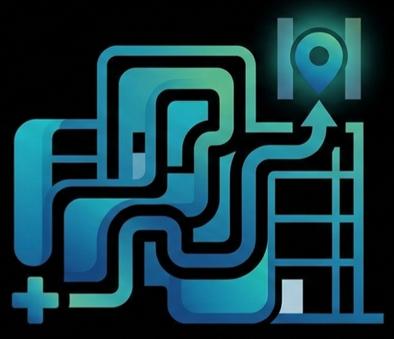
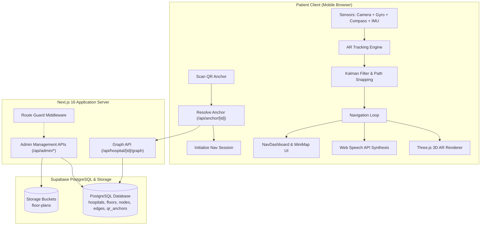

# MediRoute — Augmented Reality Indoor Hospital Navigation

<p align="center">
  
</p>

<p align="center">
  <strong>Zero-install augmented reality indoor wayfinding platform for complex medical centers.</strong>
  <br />
  <em>Engineered with Next.js 16, React 19, Three.js, WebXR Device API, custom A* pathfinding, and Supabase.</em>
</p>

<p align="center">
  
  
  
  
  
  
  
  
  
</p>

---

## 🏥 Problem Statement & Motivation

Navigating modern multi-story medical facilities is notoriously disorienting for patients, elderly visitors, and individuals with mobility impairments. GPS signals rapidly attenuate within multi-story steel and concrete buildings, producing positioning errors exceeding 30–50 meters. Traditional indoor solutions often require downloading hefty native applications ($\gt 150\,\text{MB}$) that create high friction for patients arriving for appointments or emergencies.

**MediRoute** solves this by delivering sub-meter spatial indoor wayfinding directly through the mobile web browser. Patients scan a wall-mounted QR anchor to instantly localize, followed by real-time 3D directional chevrons rendered over physical corridors and turn-by-turn voice prompts—requiring **zero app installations**.

---

## 🌟 Key Features

### 👓 Patient Navigation
- **Immersive 3D AR Wayfinding**: Projects illuminated walking pathways and dynamic directional chevrons directly onto physical floors using Three.js and the WebXR Device API.
- **Wheelchair Accessibility Mode**: Guarantees accessible routes by eliminating stairs from path calculations and prioritizing elevators and ramps.
- **Dual Visual Guidance (HUD + Dynamic MiniMap)**:
  - Top HUD turn card displays immediate maneuvers, landmark cues, and distance to turn.
  - Interactive minimap with real-time user orientation dot, path polyline, and floor elevation switcher.
- **Turn-by-Turn Voice Synthesis**: Context-aware voice guidance through the Web Speech API with landmark announcements (*"In 10 meters, turn right after the pharmacy"*).
- **Proximity Re-Anchoring**: Automatic zero-drift detection when passing near secondary QR anchors along extended corridors.

### 🛠️ Administrative Facility Management
- **Interactive Floor Blueprint Editor**: Upload PNG/JPEG floor plans or rasterize multi-page architectural CAD/PDFs in-browser via PDF.js.
- **Physical Scale Calibration**: Simple two-point reference calibration converting blueprint pixels into exact real-world meters.
- **Graph Topology Builder**: Click-to-place waypoints (`entry`, `junction`, `destination`, `elevator`, `stairs`) and define bidirectional corridor edges with custom landmarks.
- **Automated QR Sheet Generator**: Auto-generates high-density QR anchor sheets with floor/node labeling ready for one-click printing and physical installation.
- **Bulk JSON Ingestion**: Batch import pre-surveyed coordinate maps and node topologies.

---

## 📐 Algorithmic & Engineering Deep Dive

### 1. Multi-Floor A* Pathfinding with Vertical Penalties
Standard 2D A* algorithms fail in multi-story hospital environments where transitioning between floors introduces distinct physical delays and accessibility barriers. MediRoute implements a 3D-aware A* search:

$$\text{heuristic}(u, v) = \sqrt{(x_u - x_v)^2 + (y_u - y_v)^2} + |f_u - f_v| \times P_{\text{elevator}}$$

- **Vertical Penalty ($P_{\text{elevator}} = 50\,\text{m}$)**: Prevents erratic cross-floor hopping, prioritizing single-floor navigation paths unless an elevation change is strictly required.
- **Profile Weights**:
  $$\text{weight}(e) = \begin{cases} \infty & \text{if } \text{profile} = \text{wheelchair} \land (e.\text{isStairs} \lor \neg e.\text{accessible}) \\ e.\text{distanceM} & \text{otherwise} \end{cases}$$

### 2. Sensor Fusion & Spatial Tracking Pipeline
To guarantee stability without external hardware beacons, MediRoute fuses three positioning mechanisms:

1. **WebXR Visual-Inertial SLAM**: Calculates device camera translation deltas $(dx, dz)$ in local physical space relative to the starting QR anchor pose.
2. **1D Independent Kalman Filtering**: Mitigates high-frequency tracking jitter and sensor noise across $X$ and $Y$ coordinates:
   $$\hat{x}_k = \hat{x}_{k-1} + K_k (z_k - \hat{x}_{k-1}), \quad K_k = \frac{P_{k-1} + Q}{P_{k-1} + Q + R}$$
3. **Corridor Path-Snapping**: Projects raw estimated coordinates $(x, y)$ onto the nearest active corridor vector segment using scalar orthogonal projection ($t \in [0, 1]$), clamping lateral drift within a 5.0m envelope:
   $$t = \text{clamp}\left(\frac{(p - a) \cdot (b - a)}{\|b - a\|^2}, 0, 1\right)$$
4. **Dead-Reckoning Fallback (DeviceMotion)**: If visual SLAM tracking is temporarily lost (e.g. untextured walls or low-light stairwells), a peak-acceleration step detector ($a_z > \text{baseline} + 1.2\,\text{m/s}^2$) accumulates user displacement along the compass heading using average human stride modeling ($0.75\,\text{m/step}$).

### 3. Metric Scale Calibration
Architectural drawings vary widely in resolution. Administrators calibrate blueprints by clicking two known architectural references (e.g., standard 2.4m corridor or 0.9m door):

$$\text{scale (m/px)} = \frac{d_{\text{real}}}{\sqrt{(x_2 - x_1)^2 + (y_2 - y_1)^2}}$$

All coordinates are persisted in meters from the top-left origin, making navigation computations completely independent of screen density or display zoom.

---

## 🏛️ System Architecture



---

## 💻 Tech Stack

| Layer | Technology | Key Capabilities |
|---|---|---|
| **Frontend Framework** | **Next.js 16 (App Router)** | React Server Components, Turbopack, dynamic routing |
| **UI Engine** | **React 19** | Strict concurrency, optimized hooks (`useMemo`, `useRef`) |
| **Styling** | **Tailwind CSS v4** | CSS variables, `@theme inline`, OKLCH high-contrast dark palette |
| **AR & 3D Graphics** | **Three.js + WebXR Device API** | Spatial transformation matrices, chevrons, lighting, object pools |
| **Database & Auth** | **Supabase (PostgreSQL)** | RLS security policies, relational graph queries, storage buckets |
| **Audio Guidance** | **Web Speech API** | Local speech synthesis, landmark cue pronunciation |
| **Document Processing** | **PDF.js (`pdfjs-dist`)** | Client-side architectural multi-floor PDF rasterization |
| **Type Safety & Testing** | **TypeScript 5 + TSX** | Strict typing, zero-error test suite across pathfinding & AR |

---

## 📁 Repository Structure

```
mediroute/
├── app/
│   ├── (patient)/
│   │   ├── page.tsx               # Facility selector & destination search
│   │   ├── scan/page.tsx          # QR parameter resolver & cache coordinator
│   │   └── navigate/page.tsx      # Main AR engine, Three.js loop & speech controls
│   ├── (admin)/admin/
│   │   ├── page.tsx               # Hospital facility directory & registration
│   │   ├── [hospitalId]/[floor]/  # Interactive canvas floor editor & PDF rasterizer
│   │   └── [hospitalId]/qr/       # Printable QR code navigation anchor sheets
│   ├── api/                       # API route handlers
│   │   ├── admin/                 # Admin CRUD (nodes, edges, floors, bulk-upload)
│   │   ├── anchor/[anchorId]/     # Physical anchor-to-node resolution
│   │   └── hospital/[id]/graph/   # Graph topology loader with caching
│   ├── layout.tsx                 # Root HTML layout with Geist font tokens
│   └── globals.css                # OKLCH design system & Tailwind layer rules
├── components/patient/
│   ├── NavDashboard.tsx           # Turn-by-turn instruction HUD & step preview
│   └── NavMiniMap.tsx             # Responsive floor map with live heading cone
├── lib/
│   ├── ar/
│   │   ├── tracking.ts            # Spatial transforms, Kalman filter & path snapping
│   │   └── imu.ts                 # Dead reckoning fallback with step detection
│   ├── pathfinding/
│   │   ├── astar.ts               # Multi-floor wheelchair-accessible A* search
│   │   └── graph.ts               # In-memory cached Supabase graph loader
│   ├── supabase/                  # SSR browser & admin service-role clients
│   ├── voice/speech.ts            # Web Speech API synthesized audio wrapper
│   ├── constants.ts               # Arrival thresholds, noise factors & penalties
│   └── utils.ts                   # Geometric distance, bearing & turn calculation
├── public/                        # Static assets, SVG icons, sample floor plans
├── supabase/
│   ├── schema.sql                 # Complete PostgreSQL DDL with RLS & indexes
│   └── seed_demo.sql              # Ready-to-use sample hospital navigation dataset
├── tests/                         # Automated unit & simulation test suite
│   ├── astar.test.ts              # Pathfinding routing & constraint tests
│   ├── ar-tracking.test.ts        # Coordinate translation & Kalman simulations
│   ├── ar-route.test.ts           # Multi-floor elevator transition tests
│   └── floor-change.test.ts       # Manual elevation indexing tests
└── types/index.ts                 # Central domain types (GraphNode, GraphEdge, etc.)
```

---

## 🚀 Getting Started

### Prerequisites
- **Node.js 20+** installed
- A **Supabase** account (Free tier supported)
- An **ARCore-compatible Android device** running Google Chrome (for physical WebXR camera testing)

### 1. Clone & Install Dependencies
```bash
git clone https://github.com/your-username/mediroute.git
cd mediroute
npm install
```

### 2. Configure Environment Variables
Create your local environment file:
```bash
cp .env.example .env.local
```

Fill in your Supabase connection parameters:
```env
NEXT_PUBLIC_SUPABASE_URL=https://your-project.supabase.co
NEXT_PUBLIC_SUPABASE_PUBLISHABLE_KEY=your-publishable-key
SUPABASE_SECRET_KEY=your-service-role-key
NEXT_PUBLIC_APP_URL=http://localhost:3000
```

### 3. Initialize Database Schema & Seed Data
Navigate to your Supabase project's **SQL Editor** and run:
1. `supabase/schema.sql` — Initializes tables (`hospitals`, `floors`, `nodes`, `edges`, `qr_anchors`), performance indexes, RLS policies, and storage buckets.
2. `supabase/seed_demo.sql` — Populates `demo-hospital` with Floor 1 corridors, reception, radiology, cardiology, and pre-mapped QR anchors.

### 4. Run Development Server
```bash
npm run dev
```
Open [http://localhost:3000](http://localhost:3000) in your browser.

---

## 📱 Mobile WebXR Testing (Local Network HTTPS)

WebXR spatial tracking requires a secure HTTPS context. You can test directly on your mobile device using Next.js local network HTTPS:

```bash
npm run dev:network
```

1. Connect your mobile phone to the same local Wi-Fi network as your workstation.
2. Open Chrome on Android and visit:
   ```text
   https://<YOUR_LOCAL_IP>:3000
   ```
3. Accept the self-signed certificate warning to initiate camera and sensor access.

> [!TIP]
> **Desktop Testing**: You can also use the **Chrome DevTools WebXR Device Emulator** extension or Chrome Remote Debugging (`chrome://inspect`) via USB.

---

## 🧪 Verification & Test Suite

The repository includes a dedicated test suite covering pathfinding edge cases, Kalman filter simulation, and multi-floor transitions:

```bash
# Execute unit & simulation test suite
npm test

# Run static TypeScript type validation
npm run typecheck

# Run ESLint validation
npm run lint

# Build production bundle
npm run build
```

---

## 📡 API Reference

| Endpoint | Method | Access | Description |
|---|---|---|---|
| `/api/hospital/[id]/graph` | `GET` | Public | Returns complete node, edge, and anchor topology for pathfinding |
| `/api/anchor/[anchorId]` | `GET` | Public | Resolves physical QR anchor ID to hospital, floor, and coordinate waypoint |
| `/api/admin/hospitals` | `GET`, `POST` | Admin | Lists hospitals or registers a new medical facility |
| `/api/admin/floors` | `GET`, `POST`, `PATCH` | Admin | Manages floor blueprints, elevation numbers, and scale calibrations |
| `/api/admin/nodes` | `POST`, `PATCH`, `DELETE` | Admin | Creates, edits, or deletes navigation waypoints and rooms |
| `/api/admin/edges` | `POST`, `PATCH`, `DELETE` | Admin | Connects waypoints with metric distance, accessibility, and landmarks |
| `/api/admin/bulk-upload` | `POST` | Admin | Batch imports nodes and edges for automated floor plan onboarding |
| `/api/admin/upload` | `POST` | Admin | Uploads floor plan images/PDFs directly to Supabase Storage |

---

## 📄 License

This project is licensed under the [MIT License](LICENSE).
